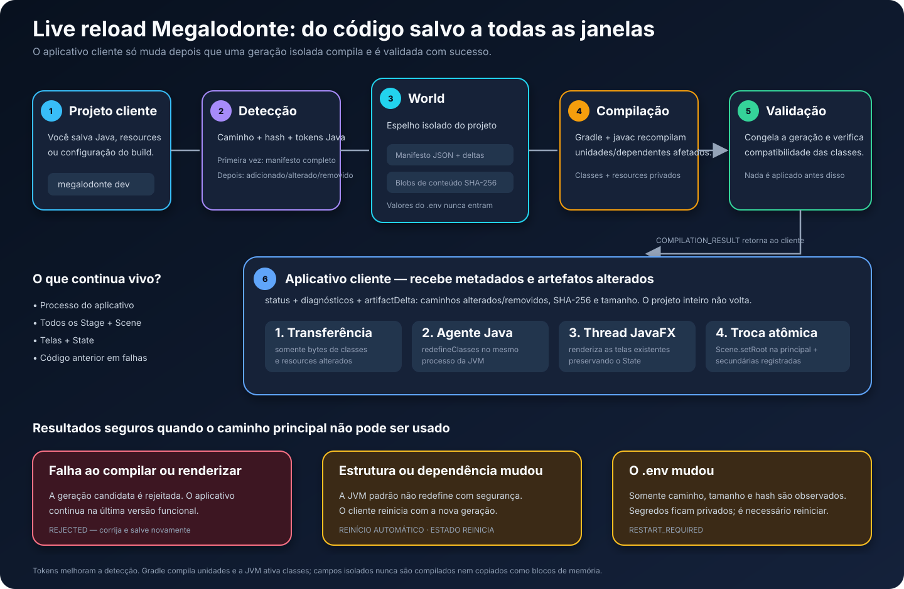

# Minastex Pedidos

Aplicativo desktop offline criado pelo CLI Megalodonte em modo nativo. A janela
usa o host Megalodonte e controles de ação e ícones de `disgust-components`.
Layouts, tabelas, formulários e navegação usam componentes Megalodonte;
campos e listas exibidas são vinculados a `State`.
O crédito **Desenvolvido por EliezerDev** fica na barra lateral e abre o
[portfólio do desenvolvedor](https://eliezer-dev.vercel.app/).
O painel inicial carrega no máximo dois destaques institucionais selecionados
para a Minastex. A seção **Soluções EliezerDev** reúne a vitrine completa sem
bloquear o trabalho quando a rede ou o feed estiverem indisponíveis. Veja a
[arquitetura da vitrine](docs/ANUNCIOS-INSTITUCIONAIS.md).

## Como usar

1. Execute `./gradlew run` com Java 25. Na primeira abertura, o aplicativo cria
   o banco local em `~/.local/share/minastex-pedidos/data.json` e cadastra os
   quatro acabamentos de referência. Os preços podem ser editados.
2. Cadastre os clientes e, se necessário, as contas bancárias. Preencha os
   dados da empresa. O site, o e-mail e os dois telefones fornecidos pela
   Minastex já vêm preenchidos e aparecem nos PDFs. A logomarca Minastex já aparece no painel e no PDF;
   selecione outra imagem PNG ou JPEG em **Empresa** se quiser substituí-la no PDF.
3. Em **Novo pedido**, selecione o cliente, adicione um grupo de acabamento e
   preencha comprimento, largura e quantidade em cada linha. O preço do
   acabamento é copiado para o grupo e pode ser alterado só nesse pedido.
4. Confira subtotal, IPI e total. Preencha as informações comerciais e escolha
   se o PDF deve conter dados bancários. Salve o pedido ou visualize/exporte o
   PDF. No histórico, é possível editar, duplicar, excluir e gerar o PDF de novo.

Os pedidos guardam o nome e documento do cliente, o nome e preço do acabamento,
a alíquota de IPI e os dados bancários usados na ocasião. Alterações posteriores
nos cadastros não recalculam pedidos antigos. Clientes e acabamentos usados em
pedidos podem ser desativados, mas não excluídos.

As listas de **Histórico**, **Clientes**, **Acabamentos** e **Contas bancárias**
mostram até 10 registros por página. Use **Anterior**, **Próxima** ou digite o
número da página; a pesquisa filtra o conjunto completo antes da paginação.

O banco é um arquivo JSON local. Faça cópias de segurança dele. Para usar outro
arquivo, execute com `-Dminastex.data=/caminho/dados.json` na JVM.

## Cálculos

- Metragem exata: comprimento × largura × quantidade.
- Valor de cada item: metragem exata × preço por m², arredondado para centavos
  com `HALF_UP`.
- Subtotal: soma dos valores já arredondados dos itens.
- IPI: subtotal × alíquota / 100, arredondado para centavos com `HALF_UP`.
- Total: subtotal + IPI. A metragem só é arredondada para exibição.

O exemplo 2,130 × 0,630 × 240 a R$ 12,94/m² resulta em 322,06 m² exibidos,
R$ 4.167,40 de subtotal, R$ 135,44 de IPI a 3,25% e R$ 4.302,84 no total.
Essa política deve ser confrontada com os PDFs comerciais reais da Minastex;
eles não vieram junto do prompt recebido.

## Desenvolvimento

`./gradlew test` valida os cálculos, a persistência de snapshots e o PDF com
paginação, título contendo número/data do pedido, tabela em grade e dados
bancários opcionais. O PDF é gerado pelo `DataPdf` de `pack-utilities`; o layout
orientado a dados está em `src/main/resources/pdf/order.jsonc`, sem coordenadas
PDFBox no código da aplicação. [Veja a arquitetura do documento](docs/PDF-ORIENTADO-A-DADOS.md).
`./gradlew run` abre a interface.
Para desenvolver com live reload, use `megalodonte dev --project .`. O CLI mapeia
este projeto no mesmo mundo de compilação genérico usado por qualquer aplicação
Megalodonte: manifesto JSON inicial, deltas de arquivos/tokens, conteúdo por hash,
compilação incremental e resposta apenas com metadados dos artefatos. O protocolo
não conhece pedidos, clientes nem telas do Minastex. Uma alteração em `.env`
exige reiniciar a sessão e seus valores não entram no JSON do protocolo. Alterações
compatíveis no corpo de métodos mantêm o processo, as telas e seus `State`. Mudanças
estruturais, como adicionar um import acompanhado de nova classe, fábrica `static`,
campo ou assinatura, reiniciam automaticamente o processo cliente para aplicar a
geração; nesse fallback, as janelas são recriadas e o estado em memória é perdido.
Use `--no-restart-on-incompatible` somente quando preferir manter a geração anterior.

O projeto foi registrado como `local_only` em `workspace.toml` e possui Git
próprio, conforme gerado pelo CLI. O motor PDF e as fontes DejaVu Sans regular e
negrito são fornecidos por `pack-utilities`; o aplicativo mantém somente o template
e a transformação dos dados do pedido.
O ícone da janela usa `src/main/resources/icon.png`; o empacotamento usa esse
PNG no Linux e `src/main/resources/icon.ico` no Windows. No Linux, a aplicação
usa um host JavaFX exclusivo para que o dock associe a janela ao ícone correto;
o framework registra a entrada de desenvolvimento com um caminho de ícone baseado
no conteúdo, evitando reaproveitar uma imagem antiga após sua atualização.

O workflow de empacotamento solicita a dependência `disgust` ao workflow
compartilhado, que prepara também `pack-utilities` antes de compilar o aplicativo.
O funcionamento e o diagnóstico estão em [Empacotamento no GitHub Actions](docs/EMPACOTAMENTO-CI.md).

## Skill de UI para agentes

O projeto inclui [`skills/megalodonte-native-ui/SKILL.md`](skills/megalodonte-native-ui/SKILL.md). O `AGENTS.md` instrui agentes a sincronizá-la e lê-la antes de alterar telas. Para fazê-la aparecer no menu `$` do Codex, instale o Megalodonte CLI (`pipx install --editable .` dentro de `framework/megalodonte-cli`) e execute `megalodonte skills install --project .`. Após atualizar o CLI, execute `megalodonte skills sync --project .` para trazer a versão atualizada; o vínculo instalado acompanhará o arquivo.
# minastex
# minastex
